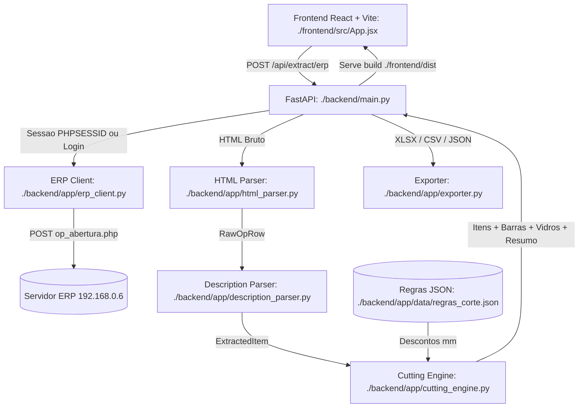

# Visão Geral: Corte local portas

**Resumo:** Sistema web (**FastAPI + React/Vite/Tailwind CSS**, identidade visual **Lider Design**) que consulta ao vivo as Ordens de Produção do local `PORTAS` no ERP (`http://192.168.0.6/pcp/op_abertura.php`), extrai estruturalmente medidas, modelos, puxadores, divisórias e acabamentos das descrições, calcula as listas de corte de perfis e vidros com descontos configuráveis e exporta para Excel/CSV/JSON.

## Arquitetura e Fluxo

## Índice de Módulos

- [[01-Frontend-UI/Interface-Web-Corte-Portas]]
- [[02-Backend-API/API-Extracao-ERP-Portas]]
- [[03-Dominio-Calculos/Regras-Extracao-e-Corte-Perfis]]
- [[04-Infra-Dados/Integracao-HTTP-ERP]]
- [[05-Automacoes/Inicializacao-Servidor-Local]]
- [[Corte-local-portas-logbook/LOGBOOK_INDEX]]
