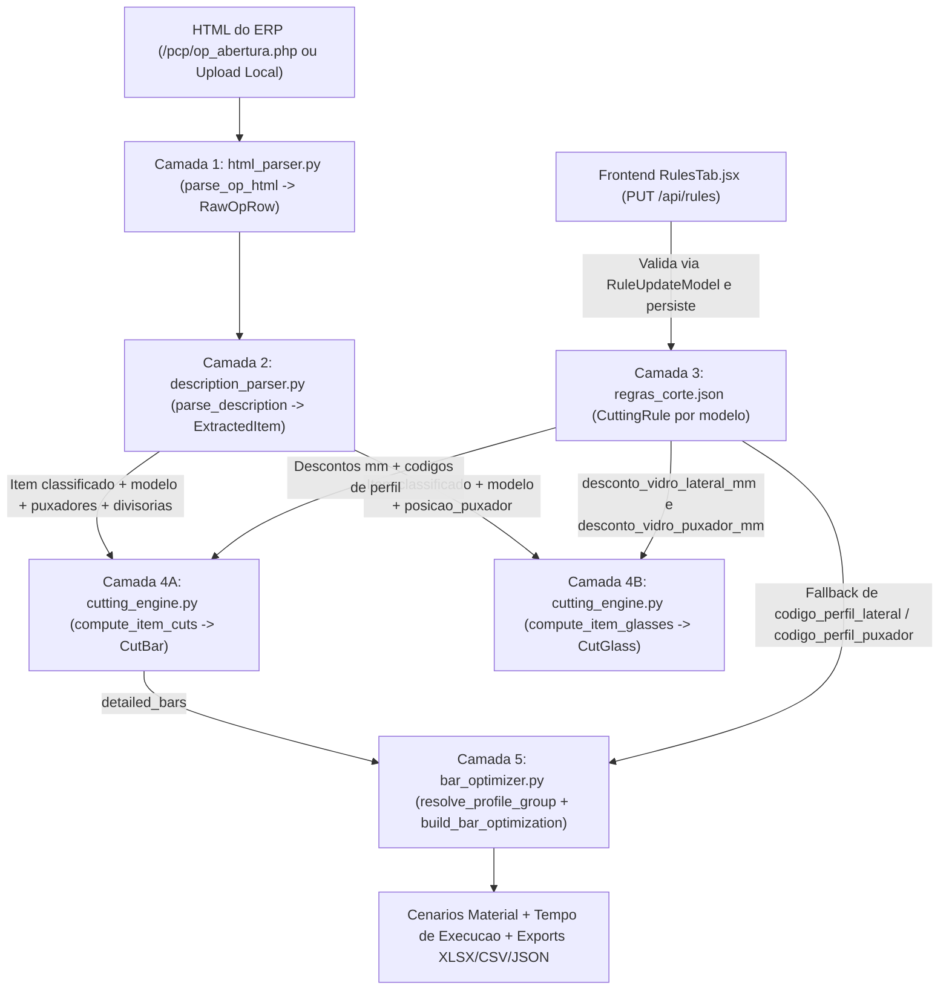
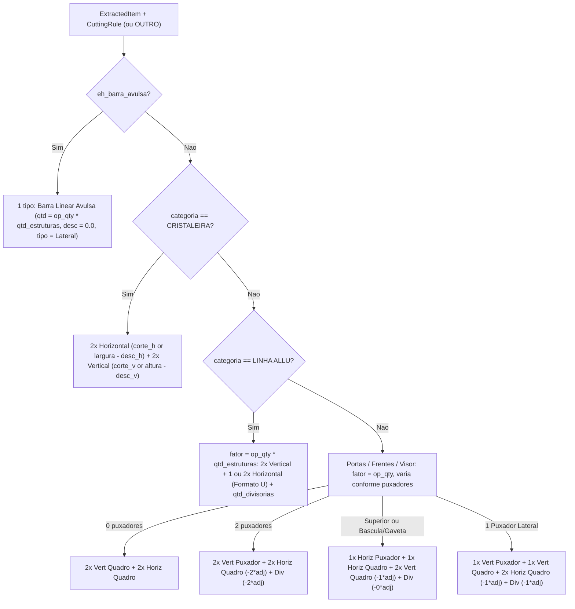

# Guia Completo de Regras de Negócio, Critérios e Manutenção

**Objetivo:** Documentar de forma completa e fiel ao código-fonte como as regras de extração, classificação, desconto, corte de perfis, corte de vidros e otimização de barras de 6 m operam hoje no projeto **Corte local portas**, destacando as particularidades de cada modelo e os procedimentos padronizados para alterar regras existentes ou inserir novos modelos com segurança no longo prazo.

---

## 1. Visão Geral e Arquitetura das Regras

O sistema possui uma **arquitetura híbrida de regras** dividida em duas camadas de governança:

1. **Regras Paramétricas (Declarativas — editáveis sem alterar código):** armazenadas em `./backend/app/data/regras_corte.json` e editáveis em tempo real na aba **Regras e Descontos (mm)** (`./frontend/src/components/RulesTab.jsx`) ou via `PUT /api/rules`. Controlam códigos de perfil para agrupamento 6 m, tipo de corte (`45°`, `90°`), larguras de perfil e descontos em milímetros.
2. **Regras Estruturais e Textuais (Programáticas — em código Python/React):** controlam como o HTML do ERP é lido (`./backend/app/html_parser.py`), como descrições heterogêneas são interpretadas (`./backend/app/description_parser.py`), como barras e vidros são decompostos geometricamente (`./backend/app/cutting_engine.py`), como as barras de 6 m são agrupadas e otimizadas (`./backend/app/bar_optimizer.py`) e como a peça é desenhada no modal 2D (`./frontend/src/components/PieceDetailDialog.jsx`).

> [!IMPORTANT]
> Cadastrar um modelo apenas em `./backend/app/data/regras_corte.json` **não faz o sistema reconhecê-lo** nas OPs do ERP. Sem a regra correspondente em `_extract_modelo()` dentro de `./backend/app/description_parser.py`, os itens continuam caindo em `"OUTRO"` com aviso de modelo não reconhecido.

### Pipeline Ponta a Ponta (5 Camadas)



### Mapa de Responsabilidades ("O que muda sem código vs O que exige código")

| Tipo de Alteração | Onde Atua | Exige Edição de Código? | Exige `npm run build` no Frontend? |
| :--- | :--- | :--- | :--- |
| Alterar descontos de perfil (V/H/Div) ou vidro (Lat/Pux) de modelo existente | `./backend/app/data/regras_corte.json` / `RulesTab.jsx` | Não (via UI ou `PUT /api/rules`) | Não |
| Alterar `codigo_perfil_lateral` / `codigo_perfil_puxador` ou larguras de perfil | `./backend/app/data/regras_corte.json` / `RulesTab.jsx` | Não (via UI ou `PUT /api/rules`) | Não |
| Alterar parâmetros de barra 6 m (comprimento, kerf, desponte, acabamento) | `OptimizationConfig` via `OptimizationTab.jsx` | Não (runtime via `POST /api/optimize/bars`) | Não |
| Corrigir typo ou novo texto de descrição para modelo/categoria já existente | `./backend/app/description_parser.py` | Sim (Python) | Não |
| Inserir novo modelo com geometria padrão (quadro 4 barras + 0/1/2 puxadores) | `regras_corte.json` + `description_parser.py` + testes | Sim (JSON + Python) | Não |
| Inserir novo modelo/categoria com geometria especial ou nova posição de puxador | `description_parser.py` + `cutting_engine.py` + `PieceDetailDialog.jsx` | Sim (Python + React) | **Sim** (rebuild `./frontend/dist/`) |
| Adicionar nova coluna/parâmetro editável na tabela de regras | `CuttingRule` + `regras_corte.json` + `RuleUpdateModel` + `RulesTab.jsx` | Sim (Python + JSON + React) | **Sim** (rebuild `./frontend/dist/`) |

---

## 2. Camada 1 — Extração do HTML do ERP (`./backend/app/html_parser.py`)

A entrada do pipeline vem do relatório `/pcp/op_abertura.php` (consulta ao vivo via `./backend/app/erp_client.py` ou arquivos `.html`/`.htm` enviados em lote via `POST /api/extract/html`).

### Metadados e Segmentação por Entrega
- `LOCAL_PATTERN`: captura `LOCAL DE PRODUÇÃO = <b>...</b>` (com ou sem acento em `PRODUÇÃO`).
- `DATA_ABERTURA_PATTERN`: captura `DATA DE ABERTURA = <b>...</b>`.
- `DELIVERY_SPLIT_PATTERN`: divide o HTML pelas seções `<b>Data de Entrega ...:</b>`, propagando `data_entrega` para todas as linhas `<tr>` subsequentes até o próximo cabeçalho de entrega.

### Mapeamento Posicional das Colunas (`<td>`)
Cada linha válida `<tr>` tem suas células limpas via `_clean_cell()` (remoção de tags HTML, `html.unescape` e colapso de espaços) e mapeadas posicionalmente:

| Índice `<td>` | Campo em `RawOpRow` | Regra de Parsing / Fallback |
| :--- | :--- | :--- |
| `0` | `codigo` | Obrigatório (linha descartada se vazio) |
| `1` | `descricao` | Obrigatório (linha descartada se vazio) |
| `2` | `quantidade` | `_parse_br_float` (`1.234,50` → `1234.5`); fallback `1.0` se vazio/inválido |
| `3` | `op` | Texto limpo |
| `4` | `observacao` | Texto limpo (opcional) |
| `5` | `pedido` | Texto limpo (opcional) |
| `6` | `item_pedido` | Texto limpo (opcional) |
| `7` | `ambiente` | Texto limpo (opcional) |
| `8` | `valor_insumos` | `_parse_br_float` ou `None` |
| `9` | `valor_mp` | `_parse_br_float` ou `None` |

### Critérios de Descarte em `_is_non_item_row()`
São ignoradas automaticamente as linhas que atendem a qualquer uma das condições:
1. Lista vazia ou todas as células vazias.
2. Primeira célula contendo `"LOCAL DE PRODU"` ou `"DATA DE ABERTURA"`.
3. Primeira célula casando com `SUMMARY_DIA_PATTERN` (`Dia DD/MM/AAAA`).
4. Primeira célula começando com `"HORAS:"`, `"INSUMOS:"` ou `"MP:"`.
5. Todas as células não vazias terminam em `,` ou casam com `PREFIX_SUMMARY_TOKEN` (`^\d+-[A-Z0-9]+,$`, tabela de contagem de prefixos do rodapé do ERP).
6. Linha com menos de `4` células `<td>`.

---

## 3. Camada 2 — Interpretação Construtiva (`./backend/app/description_parser.py`)

Toda a classificação de peças ocorre em `parse_description(row: RawOpRow) -> ExtractedItem`.

### Normalização Prévia
Antes de qualquer regra, a descrição passa por `_strip_accents()` (decomposição `NFKD` removendo sinais diacríticos) e `_norm_upper()` (colapsa espaços múltiplos e converte para **MAIÚSCULAS**).
- **Regra obrigatória de manutenção:** toda constante ou regex em `./backend/app/description_parser.py` deve ser escrita **sem acentos e em caixa alta** (ex.: `DIVISORIA`, `BASCULA`, `FURACAO`, `PRODUCAO`). Inserir `Ç` ou `Ã` em uma regra fará com que ela nunca case com `upper`.

### Precedência Estrita de Categorias (`_extract_categoria_subcategoria`)
A função avalia os blocos `if` na ordem exata abaixo — **o primeiro match vence**:

| Ordem | Categoria | Subcategoria(s) | Critérios de Detecção em `upper` | Por que a ordem importa |
| :--- | :--- | :--- | :--- | :--- |
| `1` | `LINHA ALLU` | `ESCADA ALLU`, `LATERAL NICHO ALLU`, `NICHO ALLU`, `ILHA ALLU`, `PE ALLU`, `ALLU EM U`, `BARRA ALLU` | Qualquer token ALLU (`ESCADA ALLU`, `LATERAL NICHO ALLU`, `NICHO ALLU`, `ILHA ALLU`, `PE ALLU`, `BARRA ALLU`, `ALLU EM U`, `PERFIL ALLU`) | `LATERAL NICHO ALLU` deve ser testado **antes** de `NICHO ALLU`, pois contém a substring `NICHO ALLU`. |
| `2` | `CRISTALEIRA` | `FRENTE PROVENCE URDA` | `"PROVENCE URDA"` ou `"CRISTALEIRA"` | Ativa extração de cortes explícitos no Caso 2. |
| `3` | `PRATELEIRA / TAMPO VISOR` | `TAMPO GAVETEIRO VISOR`, `PRATELEIRA VISOR` | `"TAMPO GAVETEIRO VISOR"` ou `"PRATELEIRA VISOR"` | Ativa leitura de `L X P` e `VIDRO ... LARGURA X PROFUNDIDADE`. |
| `4` | `FRENTE GAVETA` | `FRENTE GAVETA` | `"FRENTE GAVETA"` | Puxador mapeado para `"HORIZONTAL (BASCULA/GAVETA)"` salvo exceção explícita. |
| `5` | `FRENTE BASCULA` | `BASCULA INFERIOR (HF)`, `BASCULA SUPERIOR (HF)`, `BASCULA INVERSA`, `BASCULA COMUM` | `"FRENTE INFERIOR BASCULA"`, `"FRENTE SUPERIOR BASCULA"`, `"FRENTE BASCULA INVERSA"`, `"FRENTE BASCULA"` | Subtipos mais específicos precisam preceder `"FRENTE BASCULA"`. |
| `6` | `PORTA PASSAGEM / DIVISORIA` | `PORTA CASCATA`, `PORTA PASSAGEM SUSPENSA`, `PORTA FECHAMENTO PISO E TETO`, `PORTA FECHAMENTO SUSPENSA` | `"PORTA CASCATA"`, `"NOVA PORTA CASCATA"`, `"PASSAGEM SUSPENSA"`, `"FECHAMENTO PISO E TETO"`, `"FECHAMENTO SUSPENSA"` | **Crítico:** deve preceder `PORTA DE CORRER`, pois descrições de passagem/cascata contêm a palavra `"CORRER"` (ex.: `CORRER INTEIRA`). |
| `7` | `PORTA DE BATER` | `PORTA BATER` | `"PORTA BATER"` | Padrão de portas de abrir. |
| `8` | `PORTA DE CORRER` | `PORTA CORRER ESPELHEIRA`, `PORTA CORRER` | `"CORRER"`, `"SOFT CLOSING"` ou `"SISTEMA AVANTE"` | Fallback amplo de portas deslizantes. |
| `9` | `OUTRO` | `OUTRO` | Nenhum dos padrões acima | Indica descrição fora dos padrões catalogados. |

### Precedência Estrita de Modelos (`_extract_modelo`)
Primeiro, a função pré-extrai um código textual informativo (`codigo_perfil`) nesta ordem: `\d{4}/\d{4}` → `BAGUETE\s*\(([^)]+)\)` → `PERFIL\s+(\d{4})\b`.

> [!WARNING]
> **Dois campos com nomes parecidos (`ExtractedItem.codigo_perfil` vs `CutBar.codigo_perfil`):**
> O `codigo_perfil` extraído por `_extract_modelo()` é apenas **informativo** (exibido na aba de peças e no export de itens). Na geração das barras (`cutting_engine.py`) e na otimização 6 m (`bar_optimizer.py`), o sistema usa **exclusivamente** `codigo_perfil_lateral` e `codigo_perfil_puxador` definidos em `./backend/app/data/regras_corte.json`.

Em seguida, o `modelo` e o `subtipo_modelo` são resolvidos pela ordem exata:

| Ordem | Critério em `upper` (ou `categoria`/`codigo`) | `modelo` (chave JSON) | `subtipo_modelo` |
| :--- | :--- | :--- | :--- |
| `1` | `categoria == "LINHA ALLU"` | `"ALLU"` | `"QUADRO/ESCADA ALLU"` |
| `2` | `"MINI KENDO"` ou `"PROVENCE URDA"` | `"MINI KENDO + BAGUETE"` | `"PROVENCE URDA"` |
| `3` | `"CATCH"` | `"CATCH"` | `"PERLARE CATCH"` |
| `4` | Regex `PERFIL\s+5307\s+S/PUXADOR` | `"PERFIL 5307"` | `"PERLARE S/PUXADOR"` |
| `5` | `"DJEI"` | `"DJEI"` | `"VISOR"` se `"VISOR"` em `upper`, senão `"DJEI"` |
| `6` | `"CLEAR_S"`, `"CLEAR S/"` ou `"CLEAR S "` | `"CLEAR S"` | `"CLEAR_S"` |
| `7` | `"CLEAR G"` | `"CLEAR G"` | `"CLEAR G"` |
| `8` | `"RISK"` | `"RISK"` | `"RISK INCLINADO"` → `"RISK SEM USINAGEM"` → `"RISK USINADO"` → `"RISK"` |
| `9` | `"GROOVE"` | `"GROOVE"` | `"GROOVE"` |
| `10` | `"CORRER SINGULAR"` | `"SINGULAR"` | `"CASCATA SINGULAR"` |
| `11` | `"CORRER INTEIRA"` | `"INTEIRA"` | `"CORRER INTEIRA"` |
| `12` | `"5307/5317"` | `"CATCH"` | `"PERLARE CATCH"` |
| `13` | `"5307/6817"` | `"DJEI"` | `"DJEI"` |
| `14` | `codigo.upper().startswith("2PTAG")` | `"RISK"` | `"RISK SEM PUXADOR"` |
| `15` | Nenhum acima | `"OUTRO"` | `""` (gera warning) |

### Extração de Dimensões (`_extract_dimensions`)
Opera em **4 ramos mutuamente exclusivos**, retornando `(largura, altura, linear, corte_h, corte_v, vidro_l, vidro_p, eh_barra_avulsa)`:

1. **Caso 1 — Barra avulsa:** dispara se `upper` contém `"SOMENTE A BARRA"`, `"CORTAR BARRA COM"`, `"APENAS A BARRA"` ou `"APENAR A BARRA"`. Captura `(?:LARGURA\s+DE|CORTAR\s+BARRA\s+COM|MEDIDA)\s+(\d+(?:\.\d+)?)\s*(?:MM)?`, preenche `linear` e `largura = linear`, e marca `eh_barra_avulsa = True`.
2. **Caso 2 — `CRISTALEIRA`:** captura `PLACA LARGURA <L> X ALTURA <A> MM` (`largura`, `altura`) e os cortes explícitos `02 UNIDADES MEDIDA <H> MM E 02 UNIDADES MEDIDA <V> MM` (`corte_h`, `corte_v`, usados também como fallback para `largura`/`altura`).
3. **Caso 3 — `PRATELEIRA / TAMPO VISOR`:** captura `MEDI\s*DA <L> X <P>` (ou `LARGURA <L> X (PROFUNDIDADE|PORFUNDIDADE|ALTURA) <P>`), armazenando a profundidade no campo `altura_mm`. Também tenta extrair medidas explícitas de vidro via `VIDRO ... LARGURA <VL> X (PROFUNDIDADE|PORFUNDIDADE) <VP>`.
4. **Caso 4 — Padrão geral:** captura `LARGURA(?:\s+DE)?\s+(\d+(?:\.\d+)?)` e `(?:ALTURA|PROFUNDIDADE|PORFUNDIDADE)(?:\s+DE)?\s+(\d+(?:\.\d+)?)`. Se `"PERFIL LINEAR"` estiver presente em `upper`, marca `eh_barra_avulsa = True` e define `linear = altura or largura`.

### Lado, Folha e Puxadores (`_extract_lado_e_folha` e `_extract_puxadores`)

#### Lado e Posição da Folha (`_extract_lado_e_folha`)
- **Folha (`posicao_folha`):** identifica `"EXTERNA"` (`_EXTERNA_`, ` EXTERNA `, ou sufixo ` EXTERNA`), `"INTERNA"` (`_INTERNA_`, ` INTERNA `, `_INTERNA `), ou `"N/A"`.
- **Proteção contra falsos positivos no acabamento:** antes de testar `DIREITA`/`ESQUERDA` para lado único, a função recorta a string com `struct_part = re.split(r"[-_](?:PERFIL|ACABAMENTO|PLACA)\b", upper)[0]`. Assim, palavras após `- PERFIL`, `- ACABAMENTO` ou `- PLACA` nunca contaminam o lado da porta.
- Se ambos os lados aparecem (`DIREITO E ESQUERDO`, `DIREITA E ESQUERDA`, `LATERAL DIREITA E LATERAL ESQUERDA`, `DOS DOIS LADOS`, ou `has_dir and has_esq`), retorna `lado = "AMBOS"`.

#### Puxadores (`_extract_puxadores`)
Segue estritamente esta cascata de decisão:

1. **Categorias estruturalmente sem puxador** (`LINHA ALLU`, `CRISTALEIRA`, `PRATELEIRA / TAMPO VISOR`) → `tem_puxador=False`, `qtd=0`, `posicao="SEM PUXADOR"`.
2. **Tokens negativos explícitos** (`S/PUXADOR`, `S/ PUXADOR`, `SEM PUXADOR`, `SEM PUXADRO`, `_SEM PUX`, `SEM PUX`, `SEM USINAGEM`) → `False, 0, "SEM PUXADOR", ""`.
   - *Pegadinha crítica:* `CLEAR_S_PUXADOR` usa underscore (`_S_PUXADOR`), portanto **não** dispara o token `S/PUXADOR` e é corretamente interpretado como porta **com puxador**. Já `CLEAR S/PUXADOR` possui barra (`/`) e cai corretamente nesta regra negativa.
3. **Identificação do texto `tipo_puxador`** (informativo): detecta `PUX. SMART <N>MM`, `PUXADOR SLIM`, `USINADO`, `INCLINADO`, `5307/5317`, `5307/6817`, `GROOVE`, `CLEAR_S`/`CLEAR G`, `RISK`.
4. **Dois puxadores (`qtd = 2`):** qualquer um dos tokens de ambos os lados (`DIREITO E ESQUERDO`, `DIREITA E ESQUERDA`, `LATERAL DIREITA E LATERAL ESQUERDA`, `DOS DOIS LADOS`) → `True, 2, "DUPLO (DIREITA E ESQUERDA)"`.
5. **Posição explícita `SUPERIOR`:** `"PUXADOR SUPERIOR"` ou `"USINADO SUPERIOR"` → `True, 1, "SUPERIOR"`.
6. **Posição explícita `LATERAL`:** `"PUXADOR LATERAL"`, `"USINADO LATERAL"` ou `"INCLINADO LATERAL"` → `True, 1, "LATERAL (DIREITA)"` / `"LATERAL (ESQUERDA)"` / `"LATERAL"`.
7. **`FRENTE BASCULA` e `FRENTE GAVETA`:** se contiver `C/PUXADOR`, `C/ PUXADOR`, `_PUXADOR`, `USINADO`, `CATCH` ou `DJEI` → `True, 1, "HORIZONTAL (BASCULA/GAVETA)"`; caso contrário, sem puxador.
8. **`PORTA DE BATER`, `PORTA DE CORRER`, `PORTA PASSAGEM / DIVISORIA`:** se contiver `C/PUXADOR`, `C/ PUXADOR`, `_PUXADOR`, `COM PUX`, `PUXADOR SLIM`, **`RISK`**, **`DJEI`**, **`GROOVE`** ou **`CORRER INTEIRA`** → `True, 1, "LATERAL (<lado>)"` ou `"LATERAL"`. Note que nesses quatro modelos o puxador é **implícito** se não houver token negativo no passo 2!
9. **Fallback:** `False, 0, "SEM PUXADOR", ""`.

**Contrato dos valores canônicos de `posicao_puxador`** (consumidos diretamente por `cutting_engine.py` e `PieceDetailDialog.jsx`):
- `"SEM PUXADOR"`
- `"SUPERIOR"`
- `"HORIZONTAL (BASCULA/GAVETA)"`
- `"DUPLO (DIREITA E ESQUERDA)"`
- `"LATERAL (DIREITA)"`, `"LATERAL (ESQUERDA)"`, `"LATERAL"`

### Divisórias, Multiplicador, Flags, Acabamentos e Warnings
- **Divisórias (`_extract_divisorias`):** avalia 3 formatos em ordem excludente:
  1. **Linha ALLU:** `DIVISORIA \d+ - <POS>MM` → extrai lista de posições em mm.
  2. **Portas com travessa:** `(?:DIVISAO|TRAVESSA(?:\s+DE\s+DIVISAO)?)\s+A\s+<POS>MM` → posições medidas da base.
  3. **Porta com vãos (ex.: `SINGULAR`):** `VAO (INFERIOR|CENTRAL|SUPERIOR) <VAL>`. Quando há `>= 2` vãos, soma cumulativamente os tamanhos de baixo para cima gerando `N - 1` divisórias (ex.: `INFERIOR 700 / CENTRAL 800 / SUPERIOR 700` → `2` divisórias em `[700.0, 1500.0]`).
- **Multiplicador (`_extract_qtd_estruturas`):** ativo apenas quando `categoria == "LINHA ALLU"`. Mapeia `PRODUZIR UMA ESCADA` (`1`), `DUAS ESCADAS` (`2`), `TRES ESCADAS` (`3`), `QUATRO ESCADAS` (`4`); fallback `1` (portanto, `5+` escadas precisariam de nova entrada no dicionário).
- **Flags:**
  - `eh_formato_u = ("ALLU EM U" in upper or "FORMATO DE U" in upper)` — reduz de `2` para `1` travessa horizontal do quadro na Linha ALLU.
  - `eh_especial = bool(re.search(r"\b(?:ESPECIAL|ESPCIAL|ESP)\b|^ESP-", upper))`.
- **Typos históricos do ERP já tolerados pelo parser:** `APENAR A BARRA` (`APENAS A BARRA`), `PORFUNDIDADE` (`PROFUNDIDADE`), `MEDI DA` (`MEDIDA`), `SEM PUXADRO` (`SEM PUXADOR`), `ESPCIAL` (`ESPECIAL`). **Nunca remova** esses desvios ao refatorar regexes.
- **Warnings emitidos em `ExtractedItem.warnings`:**
  1. `"Dimensão largura/altura não identificada na descrição."` (não avulsa com `largura_mm is None` ou `altura_mm is None`).
  2. `"Comprimento linear da barra não identificado na descrição."` (`eh_barra_avulsa` com `medida_linear_mm is None`).
  3. `"Modelo de perfil não reconhecido automaticamente."` (`modelo == "OUTRO"`).

---

## 4. Camada 3 — Regras Paramétricas (`./backend/app/data/regras_corte.json` e `CuttingRule`)

Cada chave de `./backend/app/data/regras_corte.json` corresponde exatamente ao campo `ExtractedItem.modelo` e é desserializada na dataclass `CuttingRule` (`./backend/app/cutting_engine.py`) e validada na API pelo schema `RuleUpdateModel` (`./backend/main.py`).

### Dicionário Completo dos 19 Campos

| Campo | Tipo | Editável na UI (`RulesTab.jsx`)? | Papel nos Cálculos |
| :--- | :--- | :--- | :--- |
| `modelo` | `str` | Não (chave badge) | Identificador do modelo; deve bater exatamente com `_extract_modelo()` e a chave do JSON. |
| `descricao` | `str` | Não (somente leitura) | Descrição amigável exibida na tabela de regras. |
| `tipo_corte` | `str` | Sim (`<select>`: `"45°"`, `"45° / 90° (Misto)"`, `"90° (Topo)"`, `"90° (Explícito)"`) | Rótulo geral de corte; sincroniza na UI os ângulos `angulo_corte_quadro` e `angulo_corte_puxador`. |
| `angulo_corte_quadro` | `int` (`45` ou `90`) | Sim (`<select>`: `45°`, `90°`) | Ângulo dos encontros Quadro × Quadro (`aq`). |
| `angulo_corte_puxador` | `int` (`45` ou `90`) | Sim (`<select>`: `45°`, `90°`) | Ângulo das pontas do Puxador e encontros Puxador × Adjacente (`ap`). Quando `aq != ap`, gera barras adjacentes mistas `45° / 90°`. |
| `angulo_corte_divisoria` | `int` (`45` ou `90`) | Sim (`<select>`: `90°`, `45°`) | Ângulo das duas pontas das divisórias/travessas internas (`ad`, padrão `90°`). |
| `perfil_simetrico_lateral` | `bool` | Sim (checkbox `Simét. Lat. (//)`) | Indica se o perfil lateral/quadro permite giro de 180° na serra entre cortes 45° adjacentes (`//` com economia de chanfro) ou não pode girar (`\/`, padrão `false`). |
| `perfil_simetrico_puxador` | `bool` | Sim (checkbox `Simét. Pux. (//)`) | Indica se o perfil puxador permite giro de 180° na serra entre cortes 45° adjacentes (`//`) ou não pode girar (`\/`, padrão `false`). |
| `codigo_perfil_lateral` | `str` | Sim (`text`) | Código físico do perfil de quadro/lateral (ex.: `"5307"`). Usado por `compute_item_cuts` e priorizado por `resolve_profile_group` na otimização 6 m. |
| `codigo_perfil_puxador` | `str` | Sim (`text`) | Código físico do perfil puxador (ex.: `"5317"`). Unifica barras puxador compatíveis na otimização 6 m. |
| `largura_perfil_quadro_mm` | `float` | Sim (`number`, `min=0`) | Largura da seção do perfil lateral/quadro (`W`). Na UI, recalcula `desconto_adjacente_puxador_mm`; na otimização 6 m com `perfil_simetrico_lateral=true`, define a economia de chanfro por junção `//`. |
| `largura_perfil_puxador_mm` | `float` | Sim (`number`, `min=0`) | Largura da seção do perfil puxador (`W`). Na UI, recalcula `desconto_adjacente_puxador_mm`; na otimização 6 m com `perfil_simetrico_puxador=true`, define a economia de chanfro por junção `//`. |
| `desconto_adjacente_puxador_mm` | `float` | Sim (`number`, `min=0`) | Desconto extra aplicado nas barras **perpendiculares ao(s) puxador(es)** e nas divisórias quando o puxador é lateral/duplo. |
| `desconto_vertical_mm` | `float` | Sim (`number`, aceita negativo) | Desconto fixo subtraído das medidas verticais nominais (`altura`). |
| `desconto_horizontal_mm` | `float` | Sim (`number`, aceita negativo) | Desconto fixo subtraído das medidas horizontais nominais (`largura`). |
| `desconto_divisoria_mm` | `float` | Sim (`number`, aceita negativo) | Desconto fixo subtraído das divisórias/travessas internas (`largura`). |
| `desconto_vidro_lateral_mm` | `float` | Sim (`number`, `min=0`) | Desconto **por lado sem puxador** no cálculo do vidro/placa. |
| `desconto_vidro_puxador_mm` | `float` | Sim (`number`, `min=0`) | Desconto **por lado com puxador** no cálculo do vidro/placa. |
| `observacao` | `str` | Não (somente leitura) | Nota técnica exibida na última coluna da tabela de regras. |

### 5 Armadilhas Críticas do JSON e da API

1. **`desconto_adjacente_puxador_mm` só é recalculado no Frontend:** em `./frontend/src/components/RulesTab.jsx`, editar `largura_perfil_quadro_mm` ou `largura_perfil_puxador_mm` dispara `Math.max(0, pux - quadro)` quando ao menos um deles é `> 0`. Porém, o backend (`cutting_engine.py`) lê **diretamente** `rule.desconto_adjacente_puxador_mm` para subtrair do corte das peças adjacentes, usando `largura_perfil_quadro_mm`/`largura_perfil_puxador_mm` como `largura_perfil_mm` nas junções paralelas `//` do otimizador. Se você editar o JSON manualmente ou chamar `PUT /api/rules` via script, informe os 3 valores coerentes.
2. **`DEFAULT_RULES_BACKUP` é um snapshot do boot do servidor:** em `./backend/main.py`, `DEFAULT_RULES_BACKUP = load_rules()` é executado uma única vez quando o módulo `main` é importado. O botão **"Restaurar Padrão"** (`POST /api/rules/reset`) restaura o arquivo para o estado em que o servidor foi iniciado — **não** há um arquivo separado de fábrica. Após editar `regras_corte.json` manualmente no disco, reinicie o servidor FastAPI.
3. **A chave `"OUTRO"` é obrigatória no JSON:** tanto `compute_item_cuts` quanto `compute_item_glasses` executam `rule = rules.get(item.modelo) or rules["OUTRO"]`. Remover `"OUTRO"` derruba a extração com `KeyError`.
4. **Descontos negativos atuam como acréscimo:** os campos `desconto_vertical_mm`, `desconto_horizontal_mm` e `desconto_divisoria_mm` não restringem sinal negativo. Como `_safe_cut(nominal, discount)` calcula `round(max(0.0, nominal - discount), 3)`, um desconto de `-2.0` soma `+2.0 mm` à medida de corte.
5. **Limites da UI `RulesTab.jsx`:** a tabela renderiza automaticamente qualquer nova chave adicionada em `regras_corte.json` (ordenada alfabeticamente), mas não possui botões de "Adicionar Modelo" ou "Excluir Modelo", nem campos editáveis para `descricao` e `observacao`. Além disso, valores de `tipo_corte` fora das 4 `<option>`s do `<select>` não serão exibidos corretamente na UI.

---

## 5. Camada 4 — Fórmulas Matemáticas de Corte (`./backend/app/cutting_engine.py`)

### 5.1. Decomposição de Perfis (`compute_item_cuts`)

Todo cálculo usa `_safe_cut(nominal, discount) = round(max(0.0, nominal - discount), 3)` e `op_qty = max(1, int(round(item.quantidade)))`. Barras com `qtd <= 0` ou `nominal <= 0` são ignoradas por `add_bar()`.



#### Matriz Completa de Fórmulas do Ramo Geral (Portas, Básculas, Gavetas, Passagem, Visor)

Seja `fator = op_qty`, `adj = rule.desconto_adjacente_puxador_mm`, `dv = rule.desconto_vertical_mm`, `dh = rule.desconto_horizontal_mm`, `dd = rule.desconto_divisoria_mm` e os ângulos `aq = angulo_corte_quadro`, `ap = angulo_corte_puxador`, `ad = angulo_corte_divisoria`:

| Configuração de Puxador | Barras Geradas (`funcao_barra`, `tipo_perfil`) | Quantidade | Nominal | Desconto Total (`desconto_mm`) | Ângulos (`esq / dir`) |
| :--- | :--- | :--- | :--- | :--- | :--- |
| **`qtd_puxadores == 0`** | `Vertical Quadro` (`Lateral`) | `2 * fator` | `altura` | `dv` | `aq / aq` |
| | `Horizontal Quadro` (`Lateral`) | `2 * fator` | `largura` | `dh` | `aq / aq` |
| | `Travessa Divisória Interna` (`Lateral`, se `qtd_divisorias > 0`) | `qtd_divisorias * fator` | `largura` | `dd` | `ad / ad` |
| **`qtd_puxadores == 2`** (`DUPLO`) | `Vertical c/ Puxador (Dir/Esq)` (`Puxador`) | `2 * fator` | `altura` | `dv` | `ap / ap` |
| | `Horizontal Quadro` (`Lateral`) | `2 * fator` | `largura` | `dh + 2 * adj` | `ap / ap` |
| | `Travessa Divisória Interna` (`Lateral`, se `qtd_divisorias > 0`) | `qtd_divisorias * fator` | `largura` | `dd + 2 * adj` | `ad / ad` |
| **`posicao_puxador` em `("SUPERIOR", "HORIZONTAL (BASCULA/GAVETA)")`** | `Horizontal c/ Puxador` (`Puxador`) | `1 * fator` | `largura` | `dh` | `ap / ap` |
| | `Horizontal Quadro` (`Lateral`) | `1 * fator` | `largura` | `dh` | `aq / aq` |
| | `Vertical Quadro` (`Lateral`) | `2 * fator` | `altura` | `dv + adj` | `aq / ap` |
| | `Travessa Divisória Interna` (`Lateral`, se `qtd_divisorias > 0`) | `qtd_divisorias * fator` | `largura` | `dd` (sem `adj`) | `ad / ad` |
| **1 Puxador Lateral** (`LATERAL (...)` / fallback) | `Vertical c/ Puxador (<lado>)` (`Puxador`) | `1 * fator` | `altura` | `dv` | `ap / ap` |
| | `Vertical Quadro` (`Lateral`) | `1 * fator` | `altura` | `dv` | `aq / aq` |
| | `Horizontal Quadro` (`Lateral`) | `2 * fator` | `largura` | `dh + adj` | `aq / ap` |
| | `Travessa Divisória Interna` (`Lateral`, se `qtd_divisorias > 0`) | `qtd_divisorias * fator` | `largura` | `dd + adj` | `ad / ad` |

> [!NOTE]
> Barras lineares avulsas (`eh_barra_avulsa=True`) recebem sempre `90° / 90°`, e na Linha ALLU montantes e travessas de quadro recebem `aq / aq` enquanto as divisórias internas recebem `ad / ad`.

#### Agrupamento para Serra (`build_cutting_plan`)
Na aba **Plano de Corte de Barras** (`corte_agrupado`), as barras são consolidadas pela tupla de **11 campos**:
`(modelo, codigo_perfil, tipo_perfil, acabamento_perfil, funcao_barra, orientacao, eh_perfil_puxador, medida_corte_mm, tipo_corte, angulo_esq, angulo_dir)`.
- **Consequência prática:** como `funcao_barra` inclui o lado (`Vertical c/ Puxador (DIREITA)` vs `Vertical c/ Puxador (ESQUERDA)`), portas esquerda e direita ficam em linhas separadas no resumo da serra, mas são unificadas automaticamente no mesmo grupo físico pelo otimizador de barras de 6 m.

---

### 5.2. Cálculo de Vidros e Placas (`compute_item_glasses`)

#### Exclusões e Regra Especial do Visor
1. Itens com `categoria == "LINHA ALLU"`, `eh_barra_avulsa == True`, `largura_mm <= 0` ou `altura_mm <= 0` **não geram vidro** (`return []`).
2. **Regra especial `PRATELEIRA / TAMPO VISOR`:** quando `categoria == "PRATELEIRA / TAMPO VISOR"`, se `desconto_vidro_lateral_mm == 0.0` **E** `desconto_vidro_puxador_mm == 0.0` **E** a descrição informou `VIDRO ... LARGURA X PROFUNDIDADE`, o motor usa diretamente `vidro_largura_mm` e `vidro_profundidade_mm` com rótulo `"Explícito na descrição"`.
   - **Atenção:** como itens Visor usam o modelo `"DJEI"` e atualmente `"DJEI"` em `regras_corte.json` possui `desconto_vidro_lateral_mm = 5.0` e `desconto_vidro_puxador_mm = 20.0`, a condição `== 0.0` é falsa e o motor aplica a fórmula padrão (`2x Lateral`, ou seja `-10 mm` na largura e na profundidade).

#### Fórmulas de Vidro por Posição de Puxador
Seja `lat = rule.desconto_vidro_lateral_mm` e `pux = rule.desconto_vidro_puxador_mm`:

| Posição / Quantidade de Puxadores | Desconto Largura (`desconto_largura_mm`) | Regra Largura | Desconto Altura (`desconto_altura_mm`) | Regra Altura |
| :--- | :--- | :--- | :--- | :--- |
| **`qtd_puxadores == 0`** (`SEM PUXADOR`) | `2 * lat` | `"2x Lateral"` | `2 * lat` | `"2x Lateral"` |
| **`SUPERIOR` ou `HORIZONTAL (BASCULA/GAVETA)`** | `2 * lat` | `"2x Lateral"` | `pux + lat` | `"1x Puxador + 1x Lateral"` |
| **`qtd_puxadores == 2`** (`DUPLO`) | `2 * pux` | `"2x Puxador"` | `2 * lat` | `"2x Lateral"` |
| **1 Puxador Lateral** (`DIREITA`/`ESQUERDA`/`LATERAL`) | `pux + lat` | `"1x Puxador + 1x Lateral"` | `2 * lat` | `"2x Lateral"` |

Área total de vidro do lote:
`area_m2 = round((qtd_pecas * largura_corte_mm * altura_corte_mm) / 1_000_000.0, 4)`.

### Limitações Conhecidas do Motor Atual
- **Vidro em portas com divisórias/vãos (`SINGULAR` ou travessas):** `compute_item_glasses()` sempre gera **1 única placa inteira** nas dimensões externas da porta descontadas; o sistema não divide a placa por vão.
- **Desconto de perfil único por eixo:** no mesmo eixo (vertical ou horizontal), a barra `Puxador` e a barra `Lateral` oposta recebem exatamente o mesmo `desconto_vertical_mm` ou `desconto_horizontal_mm`. Caso um modelo futuro exija desconto longitudinal distinto entre puxador e quadro oposto, será necessário adicionar um campo novo em `CuttingRule` (Playbook 5).

---

## 6. Camada 5 — Reflexo das Regras na Otimização de Barras 6 m (`./backend/app/bar_optimizer.py`)

O otimizador converte medidas para micrômetros inteiros (`SCALE_UM = 1000`) para evitar erros de ponto flutuante e agrupa todas as peças cortáveis via `resolve_profile_group()`:

1. **Prioridade 1 — Código do Perfil na Regra (`codigo_perfil`):** consulta `bar["codigo_perfil"]` (ou fallback em `rules[modelo].codigo_perfil_puxador` / `codigo_perfil_lateral`). Se preenchido, forma `COD::<CODIGO_UPPER>`. **Modelos diferentes com o mesmo código (ex.: `CATCH`, `DJEI` e `PERFIL 5307` usando `5307` nas laterais) são unificados no mesmo estoque de barras de 6 m.**
2. **Prioridade 2 — Fallback `Modelo — Tipo`:** quando o código está vazio, agrupa por `MT::<MODELO>::<LATERAL|PUXADOR>`.
3. **Segmentação opcional por acabamento:** quando `separar_por_acabamento=True`, anexa `::ACAB::<ACABAMENTO>` à chave do grupo.

**Capacidade útil e inviabilidade:**
- `usable_um = L_um - D_um` (comprimento da barra menos desponte).
- `cap_um = usable_um + K_um` (considerando que `N` peças geram `N - 1` cortes de serra `K_um`, portanto `sum(c_i + K) <= usable + K`).
- Qualquer peça com `medida_corte_mm > comprimento_barra_mm - desponte_mm` é isolada em `pecas_inviaveis_flat`.
- **Ângulos por ponta (`angulo_esq` / `angulo_dir`) e Perfil Simétrico (`//` vs `\/`):** a medida externa individual da peça já contempla o chanfro, e o otimizador orienta peças mistas (`45° / 90°` ↔ `90° / 45°`), agrupa cortes do mesmo ângulo e contabiliza trocas de ângulo (`45° ↔ 90°`). Adicionalmente, quando duas peças consecutivas em 45° são marcadas com `perfil_simetrico=True` (`perfil_simetrico_lateral` / `perfil_simetrico_puxador`), o perfil pode girar 180° na serra (alternando `invertida=True/False`) formando encaixe paralelo `//` e recuperando o triângulo de chanfro `W = min(w_prev, w_curr, c_prev/2, c_curr/2)` por junção quando `largura_perfil_* > 0`; quando `perfil_simetrico=False`, as peças mantêm a face fixa sem giro formando corte em V `\/` com economia de `0 mm`. Ambos os cenários são desenhados proporcionalmente no diagrama SVG 1D.

Para detalhes completos dos algoritmos dos 2 cenários (`material` com encadeamento de medidas vs `tempo_execucao` com lote FFD Maior → Menor), consulte `[[03-Dominio-Calculos/Otimizacao-Barras-6m]]`.

---

## 7. Playbooks Operacionais — Como Alterar ou Inserir Regras

### Playbook 1 — Alterar descontos, larguras ou códigos de perfil de modelo existente (Sem código)

**Quando usar:** calibrar folgas de vidro, descontos de serra, largura do puxador/quadro ou cadastrar códigos de barras de 6 m (`5307`, `5317`, etc.).

1. **Via Interface Web (Recomendado):**
   - Acesse a aba **Regras e Descontos (mm)** (`RulesTab.jsx`).
   - Edite os campos numéricos/textuais desejados. Observe que alterar `Larg. Quadro` ou `Larg. Puxador` recalcula `Desc. Adj. Puxador` na hora.
   - Clique em **Salvar e Recalcular** (`PUT /api/rules`), que grava `./backend/app/data/regras_corte.json` e recalcula instantaneamente a extração ativa em `STORE`.
2. **Via edição direta de `./backend/app/data/regras_corte.json`:**
   - **Atenção 1:** se alterar `largura_perfil_quadro_mm` ou `largura_perfil_puxador_mm` direto no JSON, atualize também `desconto_adjacente_puxador_mm` manualmente (o backend não calcula a subtração sozinho).
   - **Atenção 2:** reinicie o processo `uvicorn` (`./backend/main.py`) para que `DEFAULT_RULES_BACKUP` carregue os novos valores como referência do botão *Restaurar Padrão*.
   - **Atenção 3:** valide se `test_extraction.py` possui asserções antigas sensíveis ao valor de produção (veja a Seção 8).

---

### Playbook 2 — Corrigir reconhecimento textual ou typo de modelo/categoria existente

**Quando usar:** uma OP real veio com texto diferente do esperado, gerando `modelo == "OUTRO"`, `warnings` não vazios, `posicao_puxador` errada ou `largura_mm`/`altura_mm` nula.

1. **Diagnosticar o item isolado em Python:**
   Execute no terminal a partir da raiz do projeto passando o código/descrição real para `parse_description(RawOpRow(...))` e inspecione `categoria`, `subcategoria`, `modelo`, `subtipo_modelo`, `largura_mm`, `altura_mm`, `qtd_puxadores`, `posicao_puxador`, `divisorias_mm` e `warnings`.
2. **Localizar a função correta em `./backend/app/description_parser.py`:**
   - Tipo de peça errado → `_extract_categoria_subcategoria(upper)`
   - Modelo errado → `_extract_modelo(upper, categoria, codigo)`
   - Dimensões erradas/nulas → `_extract_dimensions(upper, categoria)`
   - Lado/folha errados → `_extract_lado_e_folha(upper)`
   - Puxador errado (0 vs 1 vs 2, Superior vs Lateral) → `_extract_puxadores(upper, categoria, lado)`
   - Travessas/vãos errados → `_extract_divisorias(upper)`
3. **Escrever a condição em `upper` sem acentos e respeitando precedência:**
   - Nunca remova tokens existentes (especialmente typos históricos).
   - Verifique se a nova palavra-chave pode ocorrer em outros modelos (ex.: palavra genérica como `PERFIL` ou `ALUMINIO` quebraria dezenas de modelos; prefira tokens compostos ou delimitados por `\b`).
4. **Validar regressão:** rode a suíte de testes e o script de auditoria em lote (Seção 8) para garantir que nenhum dos outros modelos mudou indevidamente.

---

### Playbook 3 — Inserir um NOVO modelo com geometria padrão

**Pré-requisito:** a peça é um quadro retangular de 4 barras (2 verticais + 2 horizontais + travessas internas opcionais) com 0, 1 (superior/horizontal/lateral) ou 2 (duplo) puxadores e 1 placa de vidro inteira.

1. **Cadastrar a chave do modelo em `./backend/app/data/regras_corte.json`:**
   Copie o bloco abaixo, substitua `"NOVO_MODELO"` pelo identificador exato (em maiúsculas, sem conflitar com chaves existentes) e mantenha todos os **19 campos**:
   ```json
   "NOVO_MODELO": {
     "modelo": "NOVO_MODELO",
     "descricao": "Descrição amigável exibida na aba de Regras",
     "tipo_corte": "45°",
     "angulo_corte_quadro": 45,
     "angulo_corte_puxador": 45,
     "angulo_corte_divisoria": 90,
     "desconto_vertical_mm": 0.0,
     "desconto_horizontal_mm": 0.0,
     "desconto_divisoria_mm": 0.0,
     "codigo_perfil_lateral": "",
     "codigo_perfil_puxador": "",
     "largura_perfil_quadro_mm": 0.0,
     "largura_perfil_puxador_mm": 0.0,
     "desconto_adjacente_puxador_mm": 0.0,
     "desconto_vidro_lateral_mm": 0.0,
     "desconto_vidro_puxador_mm": 0.0,
     "perfil_simetrico_lateral": false,
     "perfil_simetrico_puxador": false,
     "observacao": "Observação técnica da regra"
   }
   ```
   - `tipo_corte` deve ser exatamente `"45°"`, `"45° / 90° (Misto)"`, `"90° (Topo)"` ou `"90° (Explícito)"`.
   - Se o perfil puxador for mais largo que o perfil do quadro, já calcule `desconto_adjacente_puxador_mm = largura_perfil_puxador_mm - largura_perfil_quadro_mm`.
2. **Adicionar detecção em `_extract_modelo()` (`./backend/app/description_parser.py`):**
   - Insira um `if` antes dos fallbacks por código (`"5307/5317"`, `"5307/6817"`, `2PTAG`) e **acima** de qualquer modelo cujo nome seja substring do novo (ex.: se o nome contiver `RISK`, precisa ficar antes de `if "RISK" in upper:`).
   - Retorne exatamente `("NOVO_MODELO", "<SUBTIPO>", codigo_perfil)` onde o 1º item da tupla é idêntico à chave do JSON.
3. **Revisar `_extract_puxadores()` (`./backend/app/description_parser.py`):**
   - O novo modelo escreve explicitamente `C/PUXADOR` / `PUXADOR SUPERIOR` / `PUXADOR LATERAL` / `S/PUXADOR`? Então já funciona automaticamente.
   - O novo modelo tem puxador **implícito** em portas sem escrever `C/PUXADOR` (como `RISK`, `DJEI`, `GROOVE` e `CORRER INTEIRA`)? Adicione o token correspondente na lista da linha ~473 (para portas) ou linha ~459 (para báscula/gaveta), e opcionalmente defina `tipo_puxador` nas linhas 407–427.
4. **Revisar `_extract_categoria_subcategoria()` (se aplicável):**
   - Apenas se o novo modelo introduzir um prefixo de peça diferente de `PORTA BATER`, `CORRER`, `FRENTE BASCULA`, `FRENTE GAVETA`, etc.
5. **Adicionar testes unitários em `./backend/tests/test_extraction.py`:**
   - Teste com uma `RawOpRow` real (ou sintética fiel ao ERP) validando `ex.modelo == "NOVO_MODELO"`, `ex.warnings == []`, `compute_item_cuts()` e `compute_item_glasses()` usando uma `CuttingRule` isolada.
6. **Reiniciar o backend e conferir na UI:**
   - A aba **Regras e Descontos (mm)** listará `"NOVO_MODELO"` automaticamente em ordem alfabética, sem necessidade de editar React ou rodar `npm run build`.

---

### Playbook 4 — Inserir um NOVO modelo ou categoria com geometria especial

**Quando usar:** a peça **não** segue o quadro retangular de 4 barras (ex.: barras avulsas adicionais, travessa vertical em vez de horizontal, 3 folhas agrupadas numa linha, cortes explícitos na descrição, múltiplos vidros por vão).

1. **Estender `ExtractedItem` (`./backend/app/description_parser.py`):**
   - Se precisar de novos atributos extraídos da descrição, declare-os com valor padrão (ex.: `campo_novo: int = 0`) para manter retrocompatibilidade.
2. **Atualizar funções de extração (`./backend/app/description_parser.py`):**
   - Adicione a nova categoria/subcategoria na posição de precedência correta em `_extract_categoria_subcategoria()`.
   - Atualize `_extract_dimensions()` / `_extract_divisorias()` / `_extract_modelo()` para popular os campos novos.
3. **Criar ramo dedicado em `./backend/app/cutting_engine.py`:**
   - Em `compute_item_cuts()`, insira um novo bloco `if item.categoria == "..."` (ou `if item.modelo == "..."`) antes do ramo geral de portas (linha 254), chamando `add_bar(...)` e finalizando com `return bars`.
   - Em `compute_item_glasses()`, verifique se o modelo gera placa (como portas) ou não (como `LINHA ALLU`) ou se exige fatiamento customizado.
4. **Atualizar exportações (`./backend/app/exporter.py`):**
   - Se criou campos novos em `ExtractedItem` que precisam ir para Excel/CSV, adicione-os em `_flatten_items_for_table()`.
5. **Atualizar diagrama 2D e tabelas no Frontend (`./frontend/src/`):**
   - Se a geometria muda visualmente no esquema 2D (ex.: divisórias verticais ou ausência de uma borda como no formato em U), atualize `PieceDiagramSvg` em `./frontend/src/components/PieceDetailDialog.jsx`.
   - Compile o bundle de produção: `cd frontend && npm run build`.
6. **Criar testes completos:**
   - Adicione testes em `./backend/tests/test_extraction.py` (e em `test_bar_optimizer.py` se houver nova lógica de agrupamento).

---

### Playbook 5 — Adicionar um NOVO parâmetro configurável à tabela de regras (`CuttingRule`)

**Checklist obrigatório de 6 pontos sincronizados** — omitir qualquer um causa erro em runtime ou perda silenciosa ao salvar na UI:

1. **`./backend/app/cutting_engine.py`:** adicione o novo campo com valor padrão na dataclass `CuttingRule` (ex.: `desconto_novo_mm: float = 0.0`).
2. **`./backend/app/data/regras_corte.json`:** adicione o campo em **todas** as chaves existentes (inclusive `"OUTRO"`).
3. **`./backend/main.py`:** adicione o mesmo campo em `RuleUpdateModel` (Pydantic ignora/descarta campos não declarados no `PUT /api/rules`).
4. **Motores de cálculo (`./backend/app/cutting_engine.py` e/ou `./backend/app/bar_optimizer.py`):** consuma `rule.<novo_campo>` nas funções de corte/vidro/otimização.
5. **Frontend (`./frontend/src/components/RulesTab.jsx`):**
   - Adicione `<th>` no `<thead>` e `<td>` com `<input>` no `<tbody>` (lembrando de atualizar `colSpan` da linha de loading na linha 148).
   - Se for campo texto ou select, inclua na condição de não-conversão para `Number` dentro de `handleFieldChange()`.
   - Normalize o campo dentro de `handleSaveClick()`.
   - Execute `cd frontend && npm run build` para atualizar `./frontend/dist/`.
6. **Testes:** atualize `./backend/tests/test_extraction.py` testando o cálculo com o novo parâmetro e o round-trip `GET /api/rules` → `PUT /api/rules` → recálculo.

---

### Playbook 6 — Adicionar uma NOVA posição de puxador ou um NOVO `tipo_corte`

- **Para nova `posicao_puxador` (ex.: `"INFERIOR"` ou `"4 LADOS"`):**
  1. Em `./backend/app/description_parser.py`: detectar os tokens em `_extract_puxadores()` e retornar o novo nome canônico.
  2. Em `./backend/app/cutting_engine.py` → `compute_item_cuts()`: tratar a nova posição explicitamente (lembrando que o `else:` atual assume 1 puxador lateral!).
  3. Em `./backend/app/cutting_engine.py` → `compute_item_glasses()`: tratar o desconto de vidro correspondente no novo eixo/lados (o `else:` atual também assume 1 puxador lateral!).
  4. Em `./frontend/src/components/PieceDetailDialog.jsx`: desenhar a(s) linha(s) do puxador em `PieceDiagramSvg` e executar `npm run build` em `./frontend/`.
- **Para novo `tipo_corte` (ex.: `"45° + 90°"`):**
  1. Adicionar `<option value="...">` no `<select>` de `./frontend/src/components/RulesTab.jsx` e rodar `npm run build`.

---

## 8. Protocolo de Verificação, Regressão e Auditoria em Lote

Após qualquer alteração em regras, parser ou motor de corte, execute sempre:

```powershell
# 1. Testes unitários e de integração (extração, regras, vidros, API)
python -m unittest backend/tests/test_extraction.py -v

# 2. Testes do otimizador de barras 6m (conservação, cenários, roteiro, exports)
python -m unittest backend/tests/test_bar_optimizer.py -v

# 3. Rebuild do frontend (obrigatório sempre que editar ./frontend/src/*)
cd frontend; npm run build
```

### Auditoria de Regressão em Massa sobre HTMLs Reais
Antes de finalizar alterações no `description_parser.py`, execute uma varredura sobre todos os HTMLs de amostra (ex.: `./refs/PORTAS/*.html` ou pasta histórica do PCP) para confirmar que nenhum item novo gerou warning ou caiu em `OUTRO`:

```python
import glob, sys
from collections import Counter
from pathlib import Path

sys.path.insert(0, "backend")
from app.html_parser import parse_op_html
from app.description_parser import parse_description

modelos = Counter()
warnings_list = []
for f in sorted(glob.glob("refs/PORTAS/*.html")):
    _, rows = parse_op_html(Path(f).read_text(encoding="utf-8", errors="replace"))
    for r in rows:
        ex = parse_description(r)
        modelos[ex.modelo] += 1
        if ex.warnings or ex.modelo == "OUTRO":
            warnings_list.append((Path(f).name, r.codigo, ex.modelo, ex.warnings, r.descricao))

print("Distribuicao por modelo:", dict(modelos))
print(f"Ocorrencias com warning/OUTRO: {len(warnings_list)}")
for w in warnings_list[:20]:
    print(w)
```

> [!NOTE]
> **Débito técnico conhecido nos testes (`test_specific_cases_from_plan`):**
> Em `./backend/tests/test_extraction.py`, o teste `test_specific_cases_from_plan` lê `self.rules = load_rules()` diretamente de produção (`regras_corte.json`) e afirma que `Travessa Quadro ALLU (Sup/Inf)` e `Divisória Interna ALLU` medem `275.0 mm` (desconto `0.0`). Como o arquivo de produção atualmente usa `ALLU.desconto_horizontal_mm = 24.0` e `ALLU.desconto_divisoria_mm = 24.0` (`275 - 24 = 251.0 mm`), esse teste específico falha quando a regra de produção está calibrada em `24.0 mm`. Ao escrever **novos** testes de fórmula matemática, **instacie sempre `CuttingRule(...)` em memória** (como fazem `test_glass_cutting_discounts_by_handle_position` e `test_grouping_codigo_perfil_fallback_and_params`) para não acoplar testes unitários às calibrações editáveis de chão de fábrica.

---

## 9. Roadmap de Evolução Arquitetural (Longevidade)

Para reduzir o acoplamento entre código Python/React e o crescimento do catálogo ao longo do tempo, recomenda-se evoluir os seguintes pontos em ordem de prioridade:

1. **Separar defaults de fábrica (`regras_corte.default.json`) dos overrides de produção (`regras_corte.json`):** eliminar a dependência do snapshot em memória `DEFAULT_RULES_BACKUP` e adicionar `schema_version` com migração automática de novos campos.
2. **Introduzir `geometria_tipo` declarativo na regra:** mover a escolha entre `quadro_padrao`, `allu_escada`, `corte_explicito` e `barra_avulsa` para um atributo da regra, desacoplando `compute_item_cuts()` de nomes fixos de categoria/modelo.
3. **CRUD completo de modelos na UI (`RulesTab.jsx`):** permitir criar/clonar modelos pela interface (com proteção impedindo apagar `"OUTRO"`) e editar `descricao` e `observacao` sem abrir JSON manualmente.
4. **Tabela declarativa de detecção de descrições (Data-Driven Parser):** migrar aliases, regexes de modelo e flags de puxador implícito para uma configuração estruturada ordenada por prioridade, com testes automatizados de colisão entre padrões.
5. **Suporte a múltiplos vidros por vão e desconto exclusivo da barra puxador:** fatiar vidros conforme `divisorias_mm` (ex.: `SINGULAR` e portas com travessa) e separar `desconto_barra_puxador_mm` do desconto das barras laterais/horizontais do quadro quando um novo perfil exigir.

---

## Dependências (Grafo)

**⬅️ Complementa e detalha:**
- [[03-Dominio-Calculos/Regras-Extracao-e-Corte-Perfis]]
- [[03-Dominio-Calculos/Catalogo-Modelos-e-Particularidades]]

**➡️ Relacionado a:**
- [[03-Dominio-Calculos/Otimizacao-Barras-6m]]
- [[02-Backend-API/API-Extracao-ERP-Portas]]
- [[01-Frontend-UI/Interface-Web-Corte-Portas]]
- [[00-Visao-Geral/Index_Corte_local_portas]]
